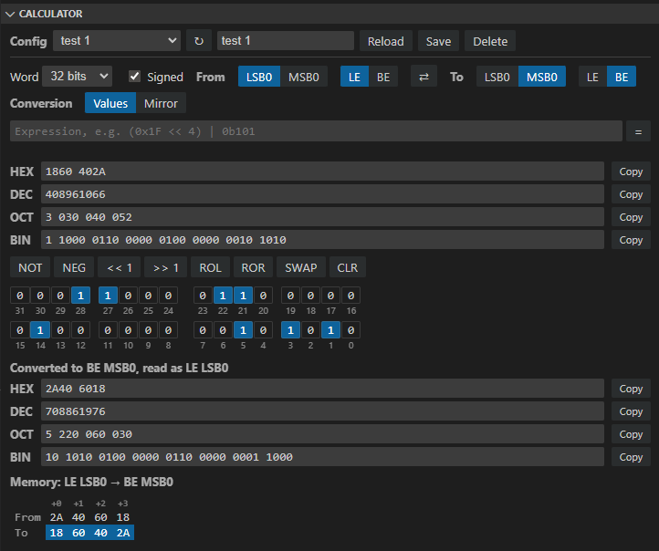
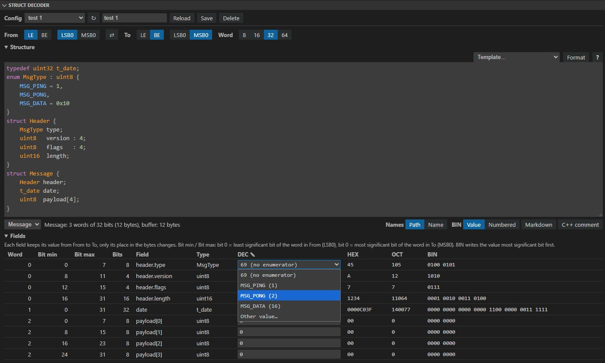
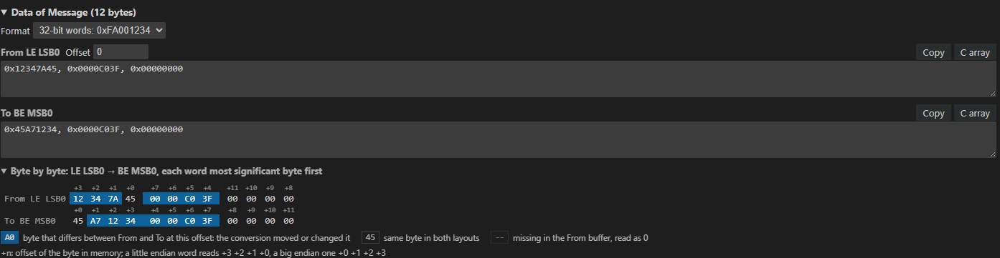

# BitCalc

A programmer calculator and a bitfield structure decoder, in the VS Code panel: hex, decimal, octal and binary views of a value, clickable bits, little or big endian, LSB0 or MSB0 bit numbering.


## Where to find it

BitCalc adds a **BitCalc** tab to the bottom panel, next to Terminal and Output, with two views: **Calculator** and **Struct Decoder**. You can drag either view to the side bar. The commands `BitCalc: Open Calculator` and `BitCalc: Open Struct Decoder` open them from the Command Palette.

Every choice made in a view (word size, signed mode, byte order, bit numbering) and its content (value, expression, structure, buffer, offset) is saved and comes back when you reopen the view, even after restarting VS Code. The saved state is global: it is the same in every workspace.

## Calculator

Works like the programmer mode of the Windows calculator.



- **Word size**: 8, 16, 32, 64 or 128 bits. Every result is truncated to that size.
- **Signed**: the decimal value and the operations use two's complement. Unchecked, the value is unsigned.
- **HEX, DEC, OCT, BIN**: type in any of the four fields, the others follow. Spaces, `_` and `'` are digit separators and the `0x`, `0o`, `0b` prefixes are accepted. A field turns red when the text is not a number, and orange when the value had to be truncated to the word size. **Copy** copies the value without separators, with its C prefix (`0x`, `0`, `0b`).
- **Bits**: click a bit to toggle it. The most significant bit is at the top left. The number under each bit is its index: counted from the least significant bit in **LSB0**, from the most significant bit in **MSB0**.
- **Operations**: `NOT`, `NEG` (two's complement negation), `<< 1`, `>> 1` (arithmetic shift when signed), `ROL` and `ROR` (rotation by one bit within the word), `SWAP` (reverse the byte order), `CLR`.

### Converting between layouts

The **From** controls give the layout of the value: bit numbering (**LSB0** or **MSB0**) and byte order (**LE** or **BE**). The **To** controls give the layout to convert it to. The value is kept: going from LE to BE reverses its bytes, and the bit numbering only changes how the bits are numbered, it does not move them.

- **Converted**: the converted value, as a reader using the From layout finds it in memory, in hex, decimal, octal and binary, with copy buttons.
- **Memory**: the bytes of the value (From) and of its conversion (To) in memory order, the bytes that differ highlighted.
- **⇄** swaps From and To and replaces the value by its conversion, so pressing it twice gives the value back.

For instance, `0x12345678` in LE LSB0 converted to BE MSB0 is stored `12 34 56 78`, read `0x78563412` with the From layout.

### Expressions

The expression field evaluates integer expressions when you press `Enter`:

| Element | Syntax |
|---|---|
| Literals | `42`, `0x2A`, `0o52`, `0b101010`, with `_` as separator |
| Unary | `-x`, `+x`, `~x` |
| Binary, by decreasing precedence | `*` `/` `%`, then `+` `-`, then `<<` `>>`, then `&`, then `^`, then `|` |
| Grouping | `( )` |

The precedence is the one of C. Every intermediate result is truncated to the word size, so in 8 bits signed `127 + 1` gives `-128`. Division truncates towards zero. On error, the message gives the column.

## Struct Decoder

Decodes a raw buffer with a C structure definition, bitfields included. Each field is shown in decimal, hex, octal and binary.





**Structure**: C declarations. Typedefs and enums first if any, then the structures, which can use the enums and each other. The last structure is decoded; when there are several, a list above the field table picks another one. A plain list of fields without braces works too. Comments are allowed. The `;` after the `}` of a structure or an enum is optional (Format drops it); fields and typedefs still end with `;`.

```c
typedef uint32 t_date;      // alias of a scalar, enum or structure type

enum MsgType : uint8 {      // underlying type, int when omitted
    MSG_PING = 1,
    MSG_PONG,               // previous + 1
    MSG_DATA = 0x10
}

struct Header {             // typedef struct { ... } Header works too
    MsgType  type;          // enum field
    uint8    version : 4;   // bitfield
    uint8            : 2;   // anonymous padding bits
    uint8    flags   : 2;
    uint16   length;        // plain field
}

struct Message {
    Header   header;        // nested structure, shown as header.type, header.version...
    uint8    data[4];       // array
    t_date   date;          // typedef alias
}
```

The declarations are coloured as you type, and the lines with an error are underlined. **Format** (or `Shift+Alt+F` in the structure) indents them and aligns the types, names, bit widths, enumerator values and trailing comments in columns; `Ctrl+Z` undoes it. Text that cannot be formatted without changing it, such as a missing `}`, is left as is.

Enumerators take a number or an expression that may use earlier enumerators (`KIND_C = KIND_A << 4`). An enum field is stored as its underlying type, can be a bitfield, and its value is shown as `NAME (value)`. It is read as signed only when the enum has a negative enumerator, so a 1 bit enum bitfield holding 1 is 1.

The **Template…** list above the structure replaces it with a ready-made one: an empty structure, a bitfields example, an enum with nested structures, an array of structures, the IPv4 and UDP headers, an RGB565 pixel, the fields of an IEEE 754 float and double. Templates written for a given byte order or bit numbering (the network headers are big endian and MSB0) also switch these options. `Ctrl+Z` in the structure brings back what was there before. The **?** button next to it shows the supported types, the syntax and the layout rules.

Known types: `uint8` to `uint64` and `int8` to `int64` (also written `u8`, `i8`, `s8`...), `char`, `unsigned char`, `byte`, `short`, `int`, `unsigned`, `long long` and their `signed` / `unsigned` forms, `bool`, `float`, `double` (also `f32`, `f64`, `float32`, `float64`). The `_t` names (`uint32_t`...) are not used: write `uint32`, the error message gives the name to use. `long` is refused because its size depends on the platform. `const`, `volatile` and `std::` are ignored. Arrays take a number of elements and can hold scalars, enums or structures (`Header items[3];`, shown as `items[0].type`, `items[1].type`...); each structure element starts a word. The field table is a tree: a nested structure or an array is a row of its own, giving its word, its first and last bit, its size in bits and its type (`Header`, `Sensor[8]`), with a button to fold its content. An open array shows its elements from a first to a last index, set by the two fields on its row (element 0 by default); each element of an array of structures is a foldable row too. The exports follow the tree, so a folded structure is exported as one row with its place and its size.

Not supported yet, to be added on request:

- an array size given by a constant or an expression: `P items[N]` (enumerator or `#define`), `P items[2 * 2]`;
- arrays of several dimensions: `P items[2][3]`;
- a structure defined in the declaration of a field: `struct { uint8 a; } items[2];` inside another structure (declare the structure before);
- typedefs of arrays: `typedef P PArr[2];`;
- pointers and unions.

**Large messages**: the Data and Byte by byte sections are folded by default and drawn only when opened; they are not updated on each change, a **Refresh** button in each draws them again (it is highlighted when they are out of date). **Show**, in the Data section, limits the buffers and the byte grid to a structure or an array of the tree (for an array, the elements shown in the table) instead of the whole message: typing in a limited buffer replaces that part of the message, and the copy buttons copy that part.

**Data**: the view reads from top to bottom: the declarations, the field table of the decoded structure, then the **Data of <structure>** section holding the bytes it is decoded from. They are written as `01 02 0A FF`, `0x01, 0x02`, `\x01\x02`, `{ 0x1, 0x2 }` or `01020AFF`; **Offset** skips the given number of bytes before the structure. The From buffer always covers the whole structure, as the To buffer does: when it is shorter, it is completed with zeros as soon as it is not being typed in (while typing, both titles say how many bytes are missing). Both buffers stop at the end of the structure; bytes after it, left by a larger structure or a longer paste, are kept but not shown (the From label gives their count) and dropped as soon as the From buffer is edited.

**Layout rules**: the structure is laid out as in an interface control document (ICD), in absolute terms, with no compiler rule. The message is a sequence of words whose size is chosen with **Word** in the toolbar (8, 16, 32 or 64 bits, 32 by default):

- The fields follow each other bit by bit inside the current word, whatever their type: only their width counts, the size of their type for a plain field, their bit width for a bitfield.
- A field that does not fit in the rest of the current word starts the next word: fields never straddle two words. A field wider than a word starts a word and fills several.
- A nested structure, such as a header, starts a word and fills whole words, so the field after it starts the next word.
- A `: 0` bitfield moves to the next word.
- Each word is stored with the chosen byte order (**LE** or **BE**), and its fields are allocated from its bit 0: the least significant bit in **LSB0**, the most significant one in **MSB0**.

`#pragma` lines and `__attribute__` annotations are ignored, so a header can be pasted as is.

The field values do not depend on the layout: only the place of the fields in the bytes changes. **Bit min** and **Bit max** hold in both layouts, each with its own numbering (LSB0: bit 0 is the least significant bit of the word; MSB0: the most significant one), HEX, OCT and BIN write the value of the field in From, most significant digit first (see Converting between layouts for the Numbered view of BIN). A line above the table recalls this.

Each row shows the **Word** holding the field, counted from 0, **Bit min** and **Bit max**, its first and last bits inside that word (restarting at 0 with each word), its width in **Bits**, and the value. A field wider than a word shows the range of its words, such as `2–3`, with its bits relative to itself.

**Names**, at the right of the summary line, chooses how the fields of nested structures are named: **Path** gives their whole path (`header.version`), **Name** only their own name (`version`), with the path in the tooltip. The exports use the same names.

**Markdown**, next to it, copies the field table as a Markdown table, under a line giving the structure, its From layout and its size in words, ready to paste in a document or a review. **CSV** copies it as CSV, cells separated by `;`, ready to paste in a spreadsheet. **C++ comment** copies the same table as `//` lines with aligned columns, in ASCII only, to paste above the structure in the code.

### Converting between layouts

The toolbar has two layouts: **From**, the byte order and bit numbering the buffer is written in, and **To**, the layout to convert it to. For instance, a structure written by a little endian compiler that allocates bitfields from the LSB (**From** LE LSB0) and expected by a big endian target that allocates them from the MSB (**To** BE MSB0).

Each field keeps its value from From to To, only its place in the bytes changes: a field holding 69 in LE LSB0 holds 69 in BE MSB0. This is the case of two systems exchanging the same data, and the To buffer gives the bytes to send.

**BIN** writes the value most significant bit first: the same bits in From and To, since the value is the same (69 is `0100 0101`). The **Columns** buttons above the table show or hide each column (pressed: shown); the Markdown and C++ exports contain the shown columns only. **Mask From** and **Mask To** give the bits of each field in the value of its word, in each layout (`lo` on bits 0-1: `0x00000003` in LSB0, `0xC0000000` in MSB0): field = (word & mask) >> lowest bit of the mask, as written in a unit test. **Word From** and **Word To**, hidden by default, give the hex value of the whole word in each layout, on the last row of the word (`0x00000345` / `0x45030000`), read in the byte order of its layout; the buffers in words formats show the bytes as they are instead. **BIN Word**, next to the summary, shows instead the whole word of the field in From and in To, the bits of the field highlighted (in the exports, dots for the other bits, and after the last field of a word holding several fields, a nearly empty row with the word, its values and its whole binary form). **BIN Numbered** shows **BIN From** and **BIN To** with the number of each bit in its convention (hover a bit) and the range under the value: for a field on bits 0 to 7, `b7 … b0` in LSB0 and `b0 … b7` in MSB0. Same bits, different labels.

The data section shows the bytes in the From layout, with the same structure in the To layout right under it. Both can be edited: typing bytes in the To data rewrites the From data through the reverse conversion. **Byte by byte** compares them word by word, each word in the reading order of its layout, most significant byte first: `+3 +2 +1 +0` for a little endian word, `+0 +1 +2 +3` for a big endian one, so a word reads as its value (`00 00 03 45` in LE LSB0, `45 03 00 00` in BE MSB0). Each layout has its own line of offsets; the bytes that differ between From and To at the same offset are highlighted, and as many words fit on a line as the view is wide. **Order** switches to **Memory**, the bytes in memory order (`+0 +1 +2 +3` for every word, as the buffer in bytes), and back to **Word**. Its **Markdown** and **C++ comment** buttons copy the comparison laid out the same way, as text (a `text` block in Markdown): offsets, bytes and the value of each word (`= 0x00000345`, as in the words formats of the buffers) for each side, all the words on one line. A legend under it explains the colours: highlighted, the byte differs between From and To at that offset; `--`, the byte is missing in the From buffer and read as 0. The **Structure** editor, the **Fields** table, the **Data** buffers and the **Byte by byte** grid can each be folded by clicking their title; the view remembers which ones are folded. **Format** chooses how both are shown, typed and copied: bytes (`FA 00` or `0xFA, 0x00`) or 16, 32 or 64-bit words (`0xFA00`...) that group the bytes in the order of the buffer, whatever the byte order of the layout: they show the buffer, not the values of its words. The **Copy** and **C array** buttons next to each one copy it in that format, as text or as `{ 0x5A, 0xF4, 0x34, 0x12 }`, ready to paste in a unit test.

**⇄** swaps the two layouts and replaces the buffer by its conversion, so the values stay the same.

Changing the **From** byte order or bit numbering keeps the values too: the DEC column holds what was typed, so the structure bytes of the buffer are rewritten in the new layout rather than read again with it. To read existing bytes with another layout, change the layout first, then paste the bytes.

In the bytes formats, the buffers show the bytes in memory order. LE LSB0 and BE MSB0 both fill a word from its first byte, so a field of whole bytes keeps its bytes in both (`45 03 00 00` for `version = 0x45, type = 3`); the words formats group these bytes as they are, `0x45030000` on both sides, which is the order the bytes are sent in. The values of the words (`0x00000345` in LE LSB0, `0x45030000` in BE MSB0) are given by the Word From / Word To columns and the exports of the byte grid.

### Editing values

The **DEC** column can be edited: type a value and press `Enter`, the buffer and its conversion are updated. Enum fields show a combo box with their enumerators; **Other value…** in it switches to typing any value. Integer fields accept the calculator expressions (`0x1F`, `-1`, `1 << 3`) and are truncated to the field width, typed enum values also accept enumerator names, `bool` fields accept `true`, `false`, `1` or `0`, `float` and `double` fields accept any number. `Escape` cancels. The focus stays on the edited field after `Enter`, and `Tab` / `Shift+Tab` (or `↓` / `↑` in a text field) write the value and go straight to the field of the next or previous row, so a whole structure can be typed from the keyboard. When the buffer is shorter than the structure, it is completed with zeros. Starting from an empty buffer, this builds the bytes of a structure field by field.

## Configurations

The **Config** bar at the top of both views saves everything they hold under a label: the calculator (value, word size, sign, layouts, expression) and the structure decoder (declarations, data, offset, layouts, word size, buffer format) together. Type a label and press **Save** (or `Enter`): the configuration is written to `.vscode/<label>.bc` in the first workspace folder, such as `.vscode/send.bc` or `.vscode/receive.bc`; an existing label is overwritten. Picking a label in the list loads it in both views. **Reload** loads the selected one again from its file, dropping the changes made since, such as a template put in the structure. **Delete** (click twice) moves the file to the trash. **↻** reads the `.vscode` folder again. The `.bc` files are plain JSON, so they can be committed with the project and shared; files added or removed by hand show up in the list. A folder must be open to save configurations.

## From the editor

Right-click in the editor and open the **BitCalc** submenu, or use the Command Palette:

| Command | What it does |
|---|---|
| Evaluate Selection in Calculator | Evaluates the selection (or the number under the cursor) in the calculator |
| Decode Selection as Buffer | Puts the selected hex bytes in the struct decoder buffer |
| Use Selection as Structure | Puts the selected C structure in the struct decoder |

## Settings

These settings are only the starting values. Everything can be changed in the views themselves, from one calculation to the next, and the views save what you chose: the settings are used again only before the first change.

| Setting | Default | Description |
|---|---|---|
| `bitcalc.wordSize` | `64` | Word size of the calculator: 8, 16, 32, 64 or 128 |
| `bitcalc.signed` | `true` | Signed (two's complement) mode of the calculator |
| `bitcalc.endianness` | `little` | Byte order: `little` or `big`. The struct decoder converts to the other one |
| `bitcalc.bitOrder` | `lsb0` | Bit numbering: `lsb0` or `msb0`. The struct decoder converts to the other one |

## Build

```sh
npm install
npm run check     # type check
npm test          # unit tests
npm run package   # builds the bitcalc-<version>.vsix
node scripts/genIcon.js   # regenerates medias/icon.png
```
